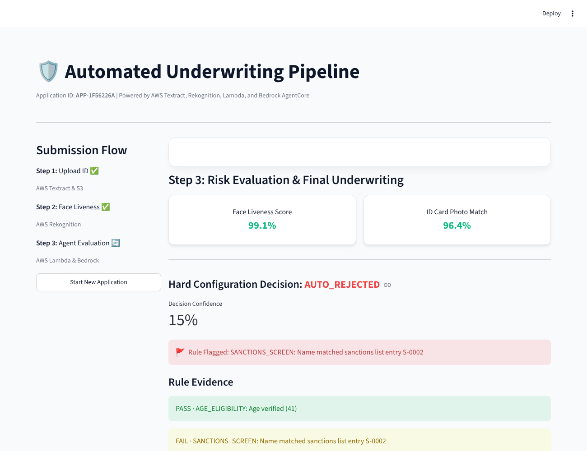
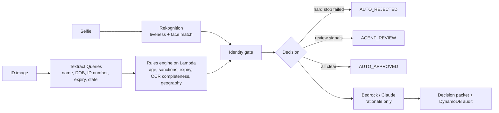

# Insurance Underwriting Agent

[](https://github.com/vijayyarabolu/insurance-underwriting-agent/actions/workflows/ci.yml)

Decision support for insurance underwriters. An applicant uploads a government ID and takes a selfie. The pipeline reads the ID, checks that the selfie is a live person who matches the ID photo, runs deterministic policy rules, and hands the underwriter a decision packet with the evidence for every rule.

The LLM never makes the decision. Hard-stop rules (age, sanctions, expired ID, failed identity check) run first and are the only thing that can reject an application. The model only writes the rationale.

It was built on AWS: Textract for ID fields, Rekognition for liveness and face match, Lambda for the rules engine, Bedrock AgentCore for the rationale, S3 with a 30-day deletion rule for ID images, and DynamoDB for the audit trail. The free-tier credits that paid for it have run out, so there is no live URL. **Demo mode runs the whole pipeline offline**, with sample applicants in place of Textract and Rekognition output.



## Try it

```bash
git clone https://github.com/vijayyarabolu/insurance-underwriting-agent
cd insurance-underwriting-agent
pip install -r requirements-dev.txt

python demo.py           # list 38 sample applicants
python demo.py u21       # sanctions match, OCR read the name surname-first
python demo.py u29       # "3rd FL" in an Illinois address is a floor, not Florida
python -m eval.run_eval  # decision eval
python -m pytest -q      # 25 tests
```

For the UI: `pip install -r requirements.txt`, then `streamlit run app.py`. In demo mode, step 1 has a **Sample applicant** picker that jumps straight to the decision.

Set `UNDERWRITING_LLM=anthropic` and `ANTHROPIC_API_KEY` to have Claude write the rationale offline. The decision still comes from the rules.

## Pipeline



## What the rules get right now

Building an eval for this turned up real bugs in the original rules. Each one has a case in `eval/applicants.jsonl` and a unit test.

| Problem in the earlier version | What happens now |
|---|---|
| OCR missing a date of birth or expiry date failed a hard-stop rule, so a blurry photo meant automatic rejection | A rule that cannot run because a field is missing routes to review. Only a rule that ran and failed can reject. |
| The sanctions check was a placeholder that only matched the first name "sanctioned" | Screens against a list with matching that ignores case, accents, hyphens and name order. Close spellings go to review. |
| The Florida weather-zone check searched the address for the token "fl", so "200 W Adams St, 3rd FL, Chicago" was flagged | The state comes from the ID's issuing state or a trailing "ST 12345" in the address. |
| Age and expiry used the machine's clock, so tests changed meaning day to day | The engine takes an `as_of` date. Evals pin it. |

The age rule already compared exact birthdays (an even earlier version subtracted years and passed people who turn 18 later in the year). The eval keeps it honest with cases for birthdays tomorrow, today and on Feb 29.

## Evaluation

38 applicants across eight categories: clean, age boundaries, expiry, missing OCR fields, sanctions variants, geography, identity checks, and combinations. Full output is in [eval/RESULTS.md](eval/RESULTS.md).

| | Earlier rules | Current rules |
|---|---|---|
| Decision accuracy | 28/38 (74%) | 38/38 (100%) |
| Unsafe auto-approvals | 5 | 0 |
| Wrongful auto-rejections | 4 | 0 |

"Unsafe auto-approvals" means an applicant who should have been rejected or reviewed was approved without a person looking at it. CI fails if that number is above zero.

**Caveats:** most of the earlier unsafe approvals came from the placeholder sanctions check, so the before column says more about missing logic than about tuning. I wrote these cases while fixing the rules, so they work as a regression suite, not an independent benchmark. The sanctions list in `data/sanctions_sample.csv` is fictional. The AWS version screened against the OFAC SDN list.

## Design notes

**Rules before the model.** Underwriting decisions have to be explainable to a regulator and repeatable. Putting the decision in deterministic code and giving the model only the explanation keeps both properties, and it means a model outage changes the wording, not the outcome.

**Review over rejection when data is missing.** A rejection is costly and hard to reverse for the applicant. When the pipeline cannot tell, it asks a person.

**Why AgentCore.** Underwriting tools touch PII, so each tool needed tight IAM scoping and persistent traces. AgentCore maps tools to IAM roles and logs traces to CloudWatch without custom orchestration code, which LangChain would have needed for the same guarantees.

## Project layout

```
scoring/        policy_rules.py, lambda_rules_engine.py, decision_support.py, pipeline.py
extraction/     Textract Queries handler
verification/   Rekognition liveness and face compare
agent/          Bedrock AgentCore client, optional Claude rationale
storage/        S3 (30-day lifecycle) and DynamoDB audit store
data/           fictional sanctions sample list
eval/           38 applicant cases, eval runner, latest results
tests/          unit tests for parsing, rules, identity gate and eval gate
```

## Project history

* **April–May 2026:** built on AWS (Textract, Rekognition, Lambda, Bedrock AgentCore, S3, DynamoDB).
* **October 2026:** the AWS free-tier credits ran out. I reset the git history to a single commit, then added the offline demo mode, the eval set, the rule fixes above and CI.

## License

MIT
